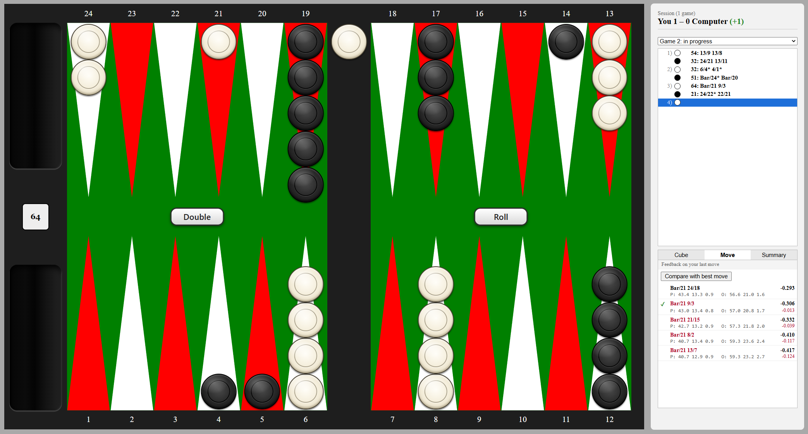
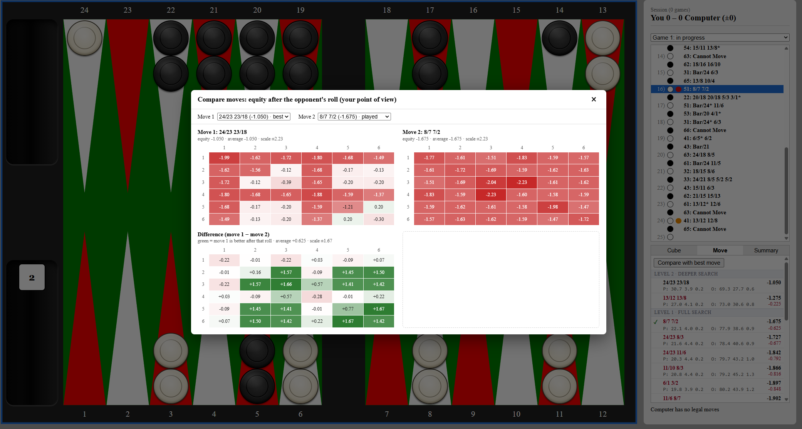
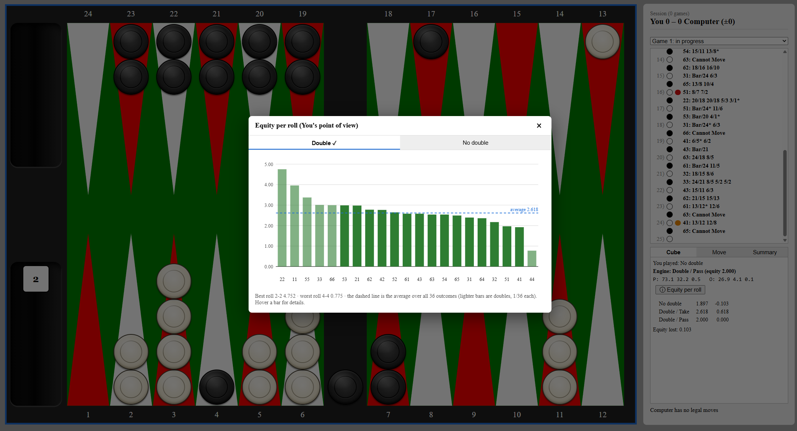

# Backgammon web client

# Backgammon web client

A browser-based backgammon game for playing money games against a custom C++ engine. 
The front end is written in TypeScript without a UI framework and was developed with help from Claude (AI), which also helped write this documentation.
The engine is a separate project and is not included in this repository, so the front end cannot run on its own.



## Features

**Play**
- Money games against the engine, including doubling, taking and dropping, with gammon and backgammon scoring.
- Running session score.
- Click-to-move checker input; legal moves are supplied by the engine.

**Analysis**
- Ranked move candidates with equity and win, gammon and backgammon probabilities.
- Doubling-cube decisions with equity comparisons and per-roll analysis.
- Move comparison with 6 × 6 dice-grid heatmaps.
- Move history with error marks and equity-loss summaries, review earlier positions and return to the game.

**Interface**
- Responsive 2D board built with plain DOM and CSS; charts are drawn in SVG.
- Analysis panel with move, cube and summary views.

## Architecture

The front end talks to the C++ engine over JSON/HTTP. 
The engine handles legal move generation, position evaluation and doubling-cube decisions and the front end handles the game flow, the interface and the game history. 
The requests and responses are typed in `src/api/types.ts`.

The game flow is one asynchronous function, kept separate from DOM rendering by a small UI interface. Everything that happens is stored in a `GameRecord`, which drives the move list and the analysis views.

## Tech stack

- **Front end:** TypeScript (strict), Vite, plain DOM, SVG and CSS.
- **Engine:** custom C++ HTTP server (separate project).

## Getting started

Requires Node.js and the separate engine server, listening on port 8080 by default.

```bash
npm install
npm run dev
```

The Vite development server proxies `/api` requests to the engine (see `vite.config.ts`).

## More screenshots

